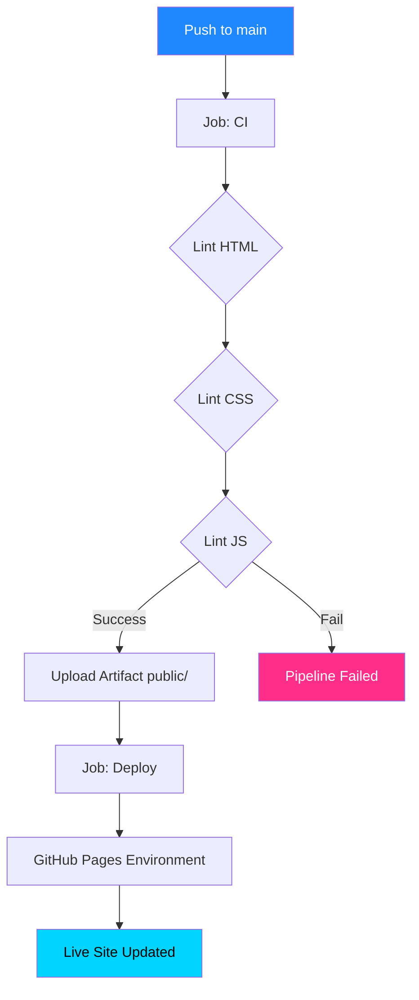
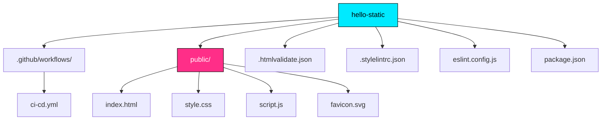

# 🌌 3D Galaxy · Hello Static

<p align="center">
  <b>Интерактивное 3D-звёздное поле на HTML5 Canvas с настоящим CI/CD на GitHub Pages</b>
</p>

<p align="center">
  <a href="https://chrisredfield48.github.io/hello-static/">
    
  </a>
  
  
  
  
</p>

---

## 🔗 Ссылки

- 🌐 **Живой сайт:** [https://chrisredfield48.github.io/hello-static/](https://chrisredfield48.github.io/hello-static/)
- 🚀 **Deployments:** [История развёртываний](https://github.com/ChrisRedfield48/hello-static/deployments)
- ⚙️ **Environments:** [Настройки окружения](https://github.com/ChrisRedfield48/hello-static/settings/environments)

---

## ✨ О проекте

**3D Galaxy** — это легковесный статический сайт, главной особенностью которого является интерактивный фон. На странице отрисовывается **800 частиц** в трёхмерном пространстве с использованием `<canvas>` и чистого JavaScript (без сторонних 3D-библиотек).

Камера реагирует на движение мыши, создавая эффект погружения в космос. Поверх анимации расположены стеклянные (glassmorphism) карточки с контентом.

Проект создан для демонстрации **идеального пайплайна CI/CD** для статических сайтов: от строгой валидации кода линтерами до автоматического деплоя на GitHub Pages.

---

## 🛠 Технологии

| Технология | Роль |
|---|---|
| **HTML5 Canvas** | Отрисовка 3D-частиц и перспективная проекция |
| **CSS3** | Стилизация, Glassmorphism, CSS-анимации |
| **JavaScript (ES6)** | Математика 3D, `requestAnimationFrame`, события мыши |
| **Node.js** | Окружение для запуска линтеров |
| **html-validate** | Валидация HTML-разметки |
| **stylelint** | Проверка стандартов CSS |
| **eslint** | Статический анализ JavaScript |
| **GitHub Actions** | CI/CD пайплайн |
| **GitHub Pages** | Хостинг и раздача статики через CDN |

---

## 🏗 CI/CD Пайплайн

В проекте реализован **настоящий Continuous Deployment**: деплой запускается только в том случае, если код успешно прошёл все проверки (гейтинг `needs: ci`).



- **CI (Continuous Integration):** При каждом пуше запускаются линтеры `html-validate`, `stylelint` и `eslint`. Если есть ошибки — пайплайн падает.
- **CD (Continuous Deployment):** Если CI зелёный, папка `public/` упаковывается в артефакт и автоматически публикуется в окружение `github-pages`.

---

## 📁 Структура проекта



---

## 💻 Локальная разработка

### 1. Установка зависимостей
Убедитесь, что у вас установлен Node.js (версия 20+).
```bash
npm ci
```

### 2. Запуск линтеров (CI локально)
Чтобы проверить код перед пушем, запустите:
```bash
npm run lint
```

### 3. Локальный просмотр
Так как это статический сайт, его не нужно собирать. Достаточно раздать папку `public/`.
Если у вас есть Docker, выполните:
```bash
docker run --rm -p 8081:80 \
  -v "$(pwd)/public":/usr/share/nginx/html:ro \
  nginx:alpine
```
И откройте [http://localhost:8081/](http://localhost:8081/) в браузере.

---

## 🚀 Как обновить сайт

Процесс деплоя полностью автоматизирован:
1. Внесите изменения в файлы в папке `public/`.
2. Проверьте локально: `npm run lint`.
3. Закоммитьте и запушьте изменения:
   ```bash
   git add .
   git commit -m "feat: update 3d stars speed"
   git push origin main
   ```
4. GitHub Actions автоматически проверит код и задеплоит новую версию на живой сайт. История обновится в разделе [Deployments](https://github.com/ChrisRedfield48/hello-static/deployments).

---

## 📄 Лицензия

Этот проект распространяется под лицензией MIT.